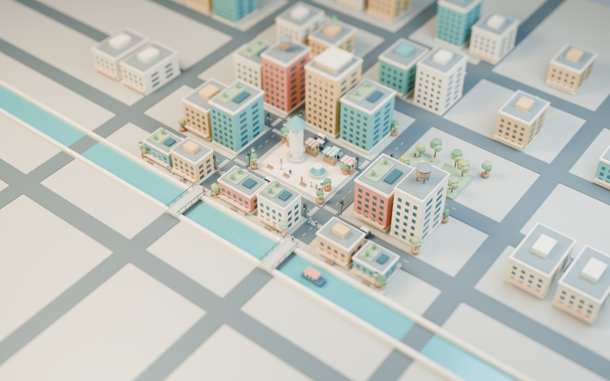
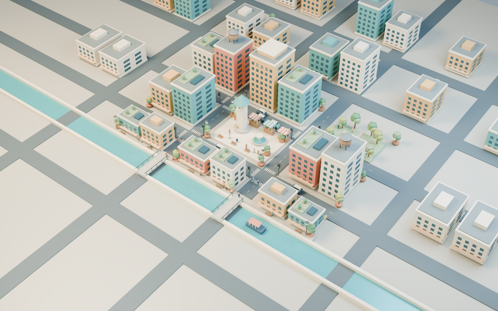

<!-- SPDX-License-Identifier: GPL-3.0-or-later -->
# Blender Tilt-Shift Camera

A tilt-shift camera implemented directly in Blender 5.3 / Cycles, with an ideal
tilted thin lens, physical aperture sampling, camera shift and image-circle clipping. The camera generates
physical rays during rendering; depth blur comes from the lens and aperture.
This repository publishes the source modifications, build tools, optical
reference, validation evidence and an editable full-scale city example.

<a href="https://ricperry.github.io/Blender-TiltShift-Camera/"></a>

**[Explore the photo & video gallery →](https://ricperry.github.io/Blender-TiltShift-Camera/)**
17 photographs · 11 comparisons · 8 camera-control videos, with original 4K
images, editable scenes and optional focus-plane overlays.
[Build or refresh it from existing artifacts](examples/DEMO_GALLERY.md).

## What tilt-shift photography does

An ordinary camera keeps its lens and sensor planes parallel. At a chosen focus
distance, its sharp plane is also parallel; the aperture determines how quickly
objects away from that plane become blurred.

**Tilt** rotates the lens about its horizontal axis, changing which depths above
and below the frame are in focus. **Swing** rotates it about its vertical axis,
doing the same across the frame. Movement Axis Rotation turns those movement
axes around the camera's optical axis. Under the **Scheimpflug condition**, the
extended lens plane, sensor plane and sharp subject plane meet along one line.
That lets a photographer align focus with a receding tabletop or ground plane,
or deliberately angle focus across a subject to leave only a narrow band sharp.

**Shift** moves the lens sideways relative to the sensor without rotating it.
It changes framing while the camera stays level: for example, frame the top of
a building while keeping its verticals parallel. Shift and lens rotation are
independent controls; a small aperture can provide broad sharpness even with
movements enabled.

The familiar **miniature illusion** combines an elevated viewpoint with shallow,
selective focus that viewers associate with close-up photographs of small
objects. Tilt can create that focus band in a full-sized scene. It does not
shrink geometry, and tilted photography can also increase useful sharpness when
the focus plane follows the subject. See the [optical model](docs/optical-model.md)
for the equations and assumptions behind this implementation.

## Try the full-scale city

Download [Full-scale Meridian (.blend)](examples/full-scale-city/full-scale-city.blend)
and open it in the patched Blender built below. The scene uses metre-scale
buildings, cars and people, with three matched 50 mm f/2.8 cameras. All three
keep depth of field enabled. The saved file defaults to CPU rendering and the
tilt-shift camera; press **F12** to render.

| Ordinary perspective + DOF | Tilt-shift camera, zero angles | Tilt-shift camera, +5° tilt |
| --- | --- | --- |
| [](examples/full-scale-city/ordinary-dof.png) | [](examples/full-scale-city/native-zero.png) | [](examples/full-scale-city/native-tilt.png) |

The previews show frame 40 at 2400 × 1500, 256 samples, seed 71 on a single
RX 6900 XT HIP device, without denoising, adaptive sampling or compositing.
See [scene instructions, camera settings and regeneration](examples/FULL_SCALE_CITY.md)
and the [packaged artifact manifest](examples/full-scale-city/manifest.json).
These examples illustrate appearance; the separate tests below establish the
bounded numerical and rendering evidence.

For a wider set of **17 photographic comparison images**, see the
[demo suite and regeneration instructions](examples/DEMO_COMPARISONS.md).
It includes a botanical tabletop with extended focus at −10° tilt, +10° city
selective focus, optimized ordinary cameras, swing, movement-axis rotation,
architectural shifts, and optional focus-plane intersections on scene surfaces. Generated 4K
images and editable scenes are available through the
[shared photo and video gallery](https://ricperry.github.io/Blender-TiltShift-Camera/).

For eight **10-second tilt-shift camera animations**, see the
[photographic controls in motion](examples/DEMO_ANIMATIONS.md) and the
[shared gallery](https://ricperry.github.io/Blender-TiltShift-Camera/). Each clip changes
one real camera setting and labels its current value in every frame.

## Build the camera

The source is official [Blender](https://projects.blender.org/blender/blender.git)
**`v5.3.0`**, commit
[`02f0899d78e374b63e7181d9061e1f7ab03419cc`](https://projects.blender.org/blender/blender/commit/02f0899d78e374b63e7181d9061e1f7ab03419cc).
This project does not vendor Blender or its dependency libraries. The current
[M4 patch](patches/blender-v5.3.0-tilt-shift-m4.patch) is cumulative against that
exact pin: apply it once, without stacking the older M2/M3 patches.

```sh
python3 scripts/prepare_blender.py --help
python3 scripts/prepare_blender.py --with-dependencies
python3 scripts/dev.py test-optics
```

Preparation downloads the official source, verifies its origin/tag/commit and
applies M4 only to the clean pin. An exact existing application is accepted;
other source edits are preserved and cause a clear failure. By default the script
downloads source only; `--with-dependencies` also fetches the large pinned Linux
library checkout and required LFS assets. All downloads, build trees, isolated
installations and regenerated renders stay under ignored `work/`.

Follow the [complete fresh GUI CPU / optional HIP build commands](docs/build-instructions.md#current-m4-fresh-gui-build)
for `work/build-blender-m4` and `work/install-blender-m4`. They use four host build
jobs under an 18 GiB memory cap and one HIP-kernel job. The installation remains
separate from system Blender. This is a Blender source patch, requiring a full
build rather than an add-on.

## Implemented scope and evidence

Select a perspective camera in Cycles and enable **Tilt-Shift** in Camera Data.
The tilt-shift interface supplies tilt, swing, axis rotation, shifts in millimetres,
focus, physical aperture and optional lens/focus/image-circle guides. Final Cycles
renders and the Cycles Rendered viewport use physical framing; ordinary solid/
Eevee camera framing is approximate. See the [interface guide](docs/m3-native-interface.md).

**Enabling the camera with zero angles can change framing.** Finite-distance
thin-lens focusing changes the lens-to-sensor distance, causing physical focus
breathing. It intentionally differs from ordinary Cycles' fixed field of view.
Disabling Tilt-Shift preserves the upstream camera path.

The [M1 optical reference](docs/optical-model.md) has 14,120 numerical checks over
1,620 deterministic rays. [M2](docs/m2-native-camera.md) validates tilt-shift physical
rays, off-axis focus, aperture blur, coverage, clipping and volumes on CPU;
[M3](docs/m3-native-interface.md) adds bounded interface, persistence, animation
and isolated GUI evidence. [M4](docs/m4-hip-camera.md) passes 19 declared CPU/HIP
render comparisons using a freshly built kernel on an actual RX 6900 XT/gfx1030.
The [M4 ledger](docs/m4-validation.json) records thresholds, provenance, retained
regressions and limitations; completed-render timings do not isolate camera-math
cost or establish general GPU speedups.

Enabled rendering supports **CPU or one non-HIPRT HIP device**. Mixed CPU/GPU,
multiple GPUs, HIPRT and other GPU backends are rejected. Support is bounded to
static perspective camera evaluation: motion blur/vector passes, stereo/multiview,
adaptive dicing and unsupported camera geometry are guarded. The measured HIP
result applies to the tested RDNA2 configuration; it does not establish other
hardware, GNOME/Mutter, accessibility, human workflow or real-lens calibration.
Coordinates, units, rotation order, singularities and tolerances are documented
in the [tilt-shift conventions](docs/m2-native-camera.md) and
[M4 numerical domain](docs/m4-hip-camera.md#physics-and-numerical-domain).

## Upstream files changed

The cumulative M4 patch modifies these **16 existing upstream files**:

```text
intern/cycles/blender/addon/ui.py
intern/cycles/blender/camera.cpp
intern/cycles/kernel/CMakeLists.txt
intern/cycles/kernel/camera/camera.h
intern/cycles/kernel/types.h
intern/cycles/scene/camera.cpp
intern/cycles/scene/camera.h
intern/cycles/scene/scene.cpp
scripts/startup/bl_ui/properties_data_camera.py
source/blender/blenkernel/BKE_camera.h
source/blender/blenkernel/intern/camera.cc
source/blender/blenloader/intern/versioning_500.cc
source/blender/draw/engines/overlay/overlay_camera.hh
source/blender/makesdna/DNA_camera_types.h
source/blender/makesrna/intern/rna_camera.cc
source/blender/makesrna/intern/rna_camera_api.cc
```

It adds **one new upstream file**:

```text
intern/cycles/kernel/camera/tilt_shift_math.h
```

Project-side reference code, scripts, examples and documentation live outside
the upstream checkout. See [patch usage](patches/README.md),
[architecture](docs/architecture.md), [integration map](docs/blender-integration.md)
and [roadmap](docs/roadmap.md). Earlier milestone records remain historical evidence.

## AI disclosure

Development was AI-assisted with **GPT-6-Astra (high reasoning)**, as identified
by the project owner, and **GPT-6.1-sol** for delegated implementation,
documentation and review. The recorded automated checks and agent visual
inspection have the scope described in the evidence ledgers; they do not imply
independent human or upstream Blender validation.

## License

Original project code, documentation and example scenes are licensed under
**GPL-3.0-or-later**. See [LICENSE](LICENSE). Blender and dependency notices remain
in their respective sources and patches.
